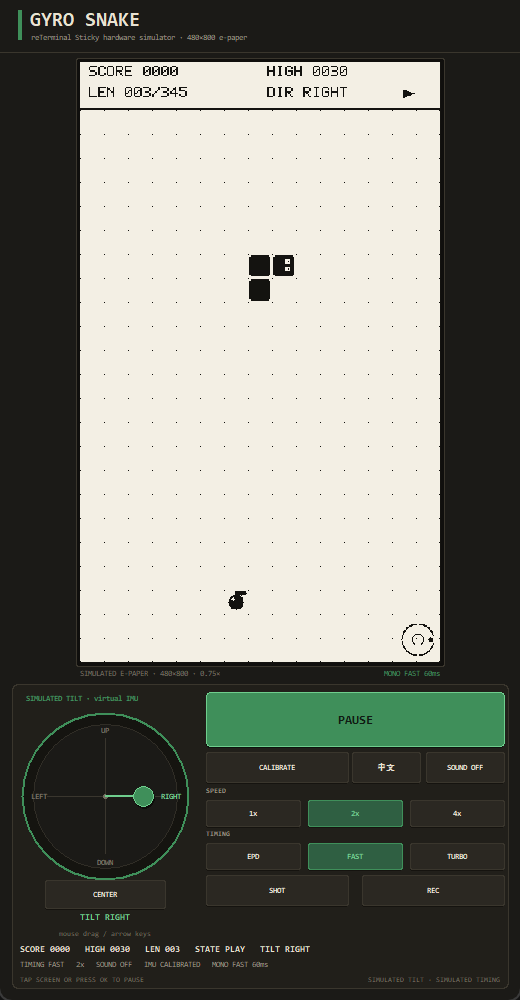

# GYRO SNAKE

reTerminal Sticky 上的**陀螺仪控制贪吃蛇**。倾斜机身改变方向，屏幕是 480×800
四级灰度电子墨水；桌面模拟器可以先用鼠标/方向键体验完整游戏。



## 玩法

- 棋盘 15×23 格、每格 32 px，顶部 64 px HUD。
- 蛇初始 3 格、向右；每显示一帧移动一格。
- 吃苹果：长度 +1、分数 +10；撞墙或撞自己：GAME OVER；填满棋盘：WIN。
- 倾斜方向：UP / RIGHT / DOWN / LEFT；8° 死区、连续 2 样本稳定、回中 4° 解锁；
  180° 反向由核心忽略。
- **右下角的实时倾斜球**：外圈 = 20° 满量程，内圈 = 8° 死区，圆点 = 当前倾斜，
  粗刻度 = 当前判定的方向；每次游戏画面刷新都会重画。**点击倾斜球 = 把当前姿态设为零点**
  （和侧面音量下键 DOWN 完全一样）。
- **点屏幕其他位置**或按 **AI/OK** 开始 / 暂停 / 继续 / 结束后回标题；**DOWN** 随时
  把当前姿态设为零点；**UP** 在 PAUSE/GAME_OVER 重新校准（PLAY 中不打断）。
- **每次开始自动校准 4 s（400 样本 @100 Hz）**：校准时的握姿就是游戏零位，所以请
  **保持你实际玩的握姿**、静止 4 秒；屏幕会显示 CALIBRATING / HOLD STILL /
  KEEP YOUR PLAY POSE。校准后还有 3 秒准备期，蛇先不动，你可以先倾斜。
- 如果中途换了握姿，点一下右下角倾斜球（或按 **DOWN**）一键 re-zero，不用重启。
- 最高分存 NVS；吃/转向/死亡/开始/校准/结束都有原创蜂鸣器短音。

## 桌面模拟器（马上玩）

```bash
cd gyro-snake
bash desktop/build.sh          # 首次构建 DLL（需要 64 位 MinGW gcc）
python desktop/play.py         # 打开窗口
```

Windows 也可以直接双击 `desktop/play.bat`（缺 DLL 时会自动构建）。

- 上半部分：480×800 屏幕按 0.75 缩放到 360×600，游戏画面和 HUD 都在里面。
- 下半部分：**虚拟倾斜盘**（鼠标拖动 / 方向键）+ START/PAUSE + CALIBRATE +
  CENTER + 速度 + 时序 + 中/EN + 音效 + 截图/录制。
- 首次 START 或点屏幕会走 3 s 模拟校准；之后每次 START/点屏幕也会重新校准；
  CALIBRATE 可随时重来；CENTER 把倾斜盘回中。
- 时序档位：**EPD**（550/1800 + 1500 ms，最接近真机）、**FAST**（120/450 + 120 ms，
  默认）、**TURBO**（40/160 + 40 ms）。所有刷新时间都是模拟值，不是面板实测。
- 语言：右上角 `中/EN` 或设置里的语言按钮；游戏内 HUD 由 C 核心渲染，保持英文。
- 自测：

```bash
python desktop/play.py --selftest --ticks 240 --out desktop/out/selftest
python desktop/play.py --window-test 3 --out desktop/out/window.png
```

## 固件

工具链：ESP-IDF **6.1.1**、esp32s3。构建机 `idf-vm`：

```bash
bash <ai_global>/meta/scripts/espidf-vm/vm-stage-build.sh \
  <项目根>/firmware --set-target esp32s3 \
  --fetch <项目根>/firmware/build-vm --log-tail 40
```

产物：`firmware/build/gyro_snake.bin`。烧录（需要真机与串口）：

```bash
idf.py -p <PORT> flash monitor
```

启动时固件先把 **GPIO45(HOLD)/GPIO46(LOCK)** 拉高，否则电池供电会掉电。

## 目录

```text
firmware/
├─ components/bsp/         上游 BSP（epd/button/pins，Apache-2.0）
├─ components/game_core/   snake.h + 便携贪吃蛇核心/渲染/字体
├─ components/imu_core/    imu_core.h + 校准/Mahony/倾角
├─ components/imu_port/    LSM6DS3TR-C I2C 驱动（ESP-IDF）
├─ components/board_port/  display/input/audio/storage
└─ main/main.c             电源保持、NVS、任务装配
desktop/                   Tkinter 模拟器 + ctypes DLL
tests/                     核心与 IMU 单元测试
docs/                      需求、架构、IMU 校准、硬件、测试记录
```

## 已验证 / 未验证

**已验证**

- 核心单测：`TESTS passed=522 failed=0`（gcc）。
- IMU 单测：`TESTS passed=179 failed=0`（模拟零偏/重力/倾角）。
- DLL：`bash desktop/build.sh` + `DLL_SMOKE ok`。
- 桌面自测：`SNAKE_SELFTEST ok frames=14 score=10`。
- 窗口测试：`SNAKE_WINDOW ok ... size=520x1000`。
- 固件：ESP-IDF v6.1.1 构建成功，`gyro_snake.bin`（见 `docs/test-results.md`）。

**未验证**

- 真机 IMU 轴向、噪声、校准收敛；`imu_port.h` 的 `IMU_PORT_AXIS_*` 需要真机四方向检查。
- 真机烧录、EPD 实际刷新耗时/残影、按键手感、蜂鸣器音量、电池续航。
- GT911 坐标映射的轴向翻转尚未用真机已知角落实测标定；触摸驱动每次按下都会打印
  `tap raw=... -> screen=...`，据此可一键校正。多点触控与滑动未实现。
- ESP-IDF 6.0.2 对照构建（实际 6.1.1）。

## 参考与许可

- BSP 来自 CodeCraft AI Hardware，Apache-2.0；版权头保留，见 `NOTICE`。
- IMU 校准/Mahony 算法以 `MagicRobot_V0.1/embedded` 的实际代码路径为参考
  （不是照抄注释）；关键差异见 `docs/imu-calibration.md`。
- 游戏、渲染、音效、文档为本项目原创；贪吃蛇是通用玩法，不含第三方游戏素材。